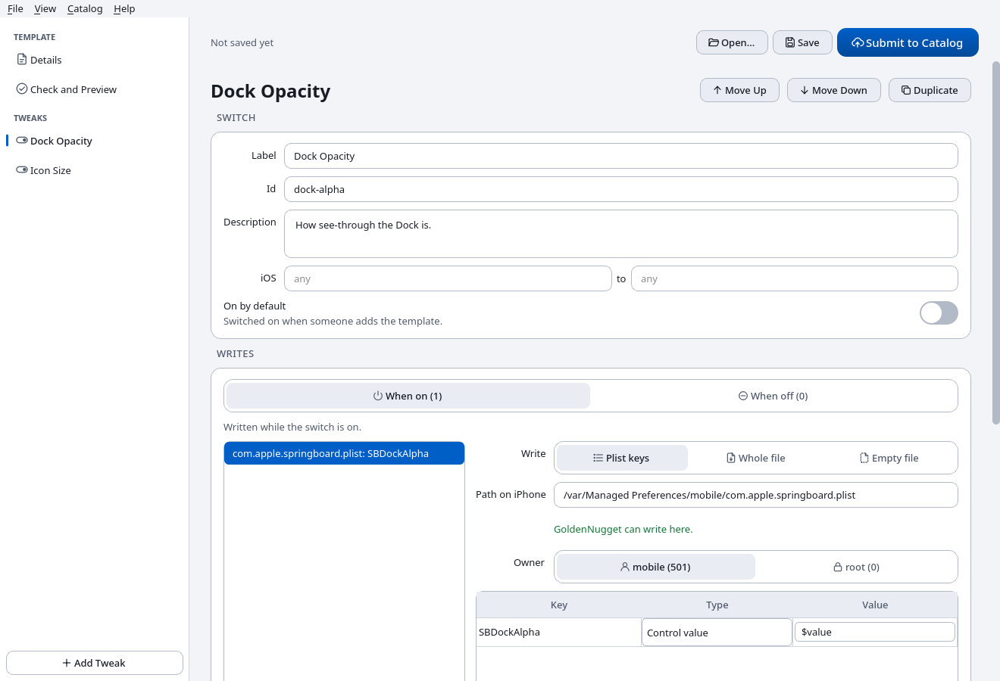
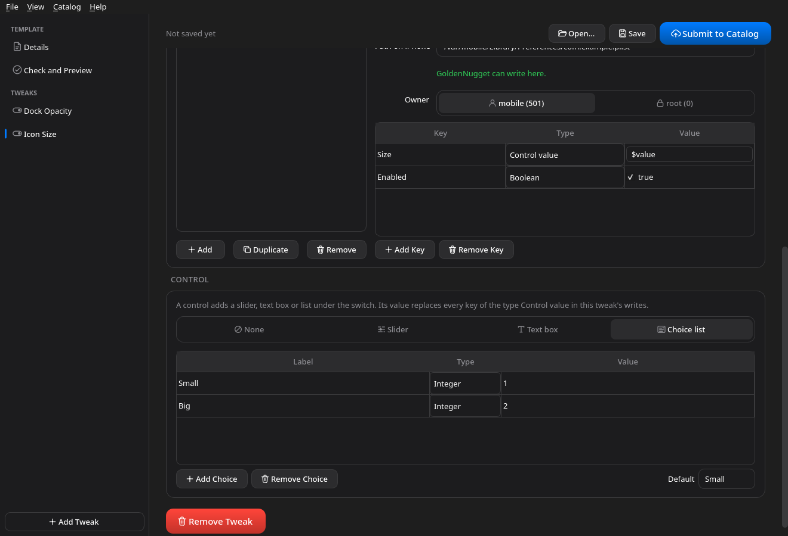
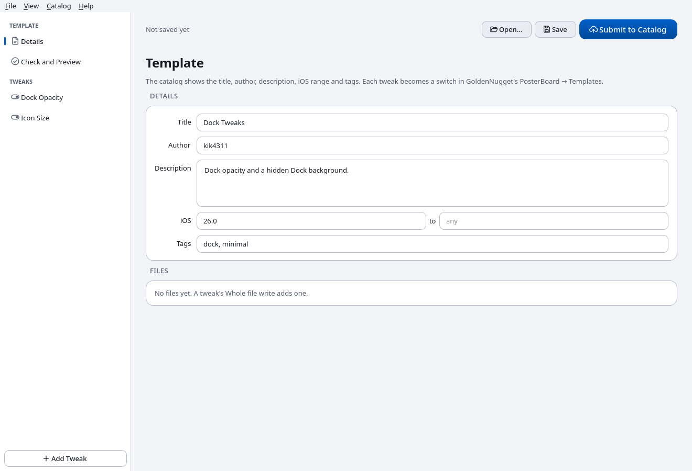
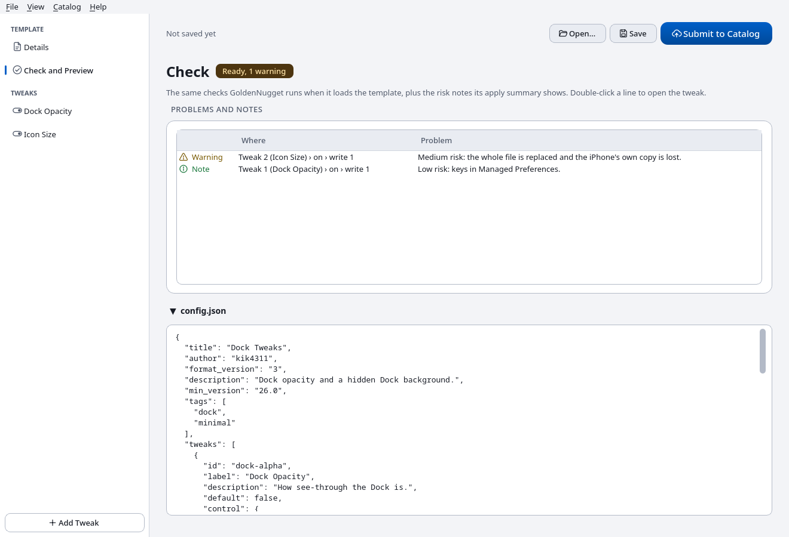
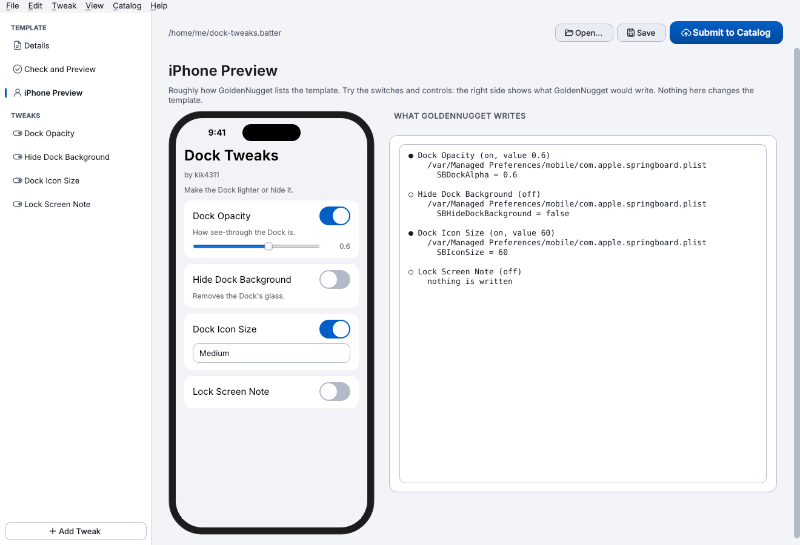

<p align="center">
  
</p>

<h1 align="center">Batter Builder</h1>

<p align="center">
  <a href="https://github.com/GoldenNugget-Team/GoldenNugget-TemplateBuilder/releases/latest">Download</a> ·
  <a href="https://github.com/GoldenNugget-Team/GoldenNugget-Presets">Community catalog</a> ·
  <a href="https://github.com/GoldenNugget-Team/GoldenNugget">GoldenNugget</a>
</p>

A visual editor for [GoldenNugget](https://github.com/GoldenNugget-Team/GoldenNugget)
`.batter` templates with **community tweaks**: switches, sliders, text boxes and
choice lists that write plist keys or files on the iPhone, the same places
GoldenNugget's built-in tweaks write to. No JSON by hand.

| Light | Dark |
|---|---|
|  |  |

## What it does

- **Template details**: title, author, description, iOS range and catalog tags.
- **Tweaks**: label, id, description, iOS range and whether the switch starts on.
- **Writes** for when the switch is on and when it is off:
  - plist keys, typed (Boolean, Integer, Real, String, arrays and dictionaries,
    or the control's value);
  - a whole file you pick, stored inside the template;
  - an empty file.

  The path box suggests the Managed Preferences files GoldenNugget itself uses
  and says right away whether GoldenNugget can write there. **Import from
  Plist…** takes the keys you tick from an existing `.plist` file.
- **Controls**: a slider, text box or choice list whose value replaces every key
  of the type *Control value*.
- **Check**: every rule GoldenNugget applies when it loads a template, plus the
  risk notes its apply summary shows:
  - low for keys in Managed Preferences;
  - medium for a whole file elsewhere;
  - high for system folders.

  Errors are counted in the sidebar next to the tweak they belong to.
- **config.json preview** of exactly what will be saved.
- **iPhone Preview**: the template roughly as GoldenNugget lists it, with
  working switches and controls, next to what GoldenNugget would write for
  them (the control's value filled in).
- **Opening existing templates** keeps their wallpaper options, containers,
  previews and other files, so you can add tweaks to a template you already have.
- **Submit to Catalog** checks the template, saves it as `<id>.batter` and
  opens the upload page of the
  [community catalog](https://github.com/GoldenNugget-Team/GoldenNugget-Presets),
  where GitHub turns it into a pull request.
- **Guided Tour** (Help → Guided Tour): the app builds an example template by
  itself, explaining each step. Pause, skip steps, or end it with Esc or End Tour.
  Your own template comes back when the tour ends, and nothing is saved.
- **Undo and Redo** (Edit menu, Ctrl+Z / Ctrl+Shift+Z) for every change, including removed tweaks.
- **Reordering**: drag tweaks in the sidebar, or use the Tweak menu
  (Ctrl+T adds, Ctrl+D duplicates, Alt+↑/↓ moves).
- **Saving** warns when GoldenNugget would refuse the template, and
  Details → Files removes files no tweak uses.
- **Unsaved changes are kept** every minute and offered back if the app did
  not close normally.
- **File → Open Recent** and dragging a `.batter` file onto the window open it.
- **Updates**: the app tells you when a new release is out (Help → Check for Updates).
- **English and Russian** (View → Language), following the system by default.
- Light and dark appearance (View → Appearance), following the system by default.

| Template details | Check and preview |
|---|---|
|  |  |



## Run it

You need Python 3.10 or newer.

```bash
git clone https://github.com/GoldenNugget-Team/GoldenNugget-TemplateBuilder.git
cd GoldenNugget-TemplateBuilder
python -m pip install -r requirements.txt
python main.py
```

`python main.py my-template.batter` opens a template directly.

Packaged builds are attached to the
[releases](https://github.com/GoldenNugget-Team/GoldenNugget-TemplateBuilder/releases):

- **macOS**: `BatterBuilder-macOS-Universal2.dmg` (or the `.zip`). It is one app for Intel and Apple Silicon and needs macOS 12 Monterey or later. It is ad-hoc signed and not notarized, so the first time, right-click the app and choose Open.
- **Windows**: `BatterBuilder-Windows.zip`.
- **Linux**: `BatterBuilder-Linux.zip`.

## Making a tweak

New to it? Start with **Help → Guided Tour**.

1. Give the template a title and an author on **Details**.
2. Open the tweak in the sidebar, or click **Add Tweak**. Give it a label and an id.
   Presets remember the switch by its id, so keep the id stable once it is shared.
3. Under **Writes → When on**, add what the switch writes. For keys that GoldenNugget
   should merge with its own, use a file in `/var/Managed Preferences/mobile/`.
4. To put a key back when the switch is turned off, add a write under **When off**.
5. Optional: pick a **Control**, then set the type of the key it fills to
   *Control value*.
6. When **Check** says *Ready*, save. To share it, use **Submit to Catalog**.

Only submit keys you have tested on a real device, and say in the description
which iOS versions you tested and every file the template writes outside
Managed Preferences. The format is described in GoldenNugget's
[documentation](https://github.com/GoldenNugget-Team/GoldenNugget/blob/main/documentation.md)
under *Community Tweaks (format 3)*.

## For developers

```
batter_builder/
  model.py      template data and config.json conversion
  rules.py      GoldenNugget's template checks and risk notes
  batter.py     reading and writing .batter archives
  locations.py  suggested paths and files GoldenNugget writes itself
  ui/           the editor (PySide6 + awesomeUI)
  ui/icons/     line icons, drawn white and tinted to the theme
assets/         the app icon (icon.svg, icon-small.svg for 16-32 px)
awesomeui/      awesomeUI controls, copied from GoldenNugget
tests/
```

`rules.py` mirrors these GoldenNugget files:

- `src/tweaks/posterboard/community_tweaks.py`
- `src/restore/path_mapping.py`

When GoldenNugget changes them, change `rules.py` too.
`tests/test_goldennugget.py` loads templates saved here with GoldenNugget's own
loader and compares the path rules. CI runs it against GoldenNugget's `main`
every day, so drift shows up as a failing check.

The macOS release is built by `tools/build_macos.py`, adapted from GoldenNugget's macOS packaging:

- a python.org universal2 Python and PySide6's universal2 wheels (`requirements-macos.txt`);
- PyInstaller with `--target-arch universal2`;
- `tools/validate_macos.py`, which checks both slices of every binary and the macOS 12.0 floor;
- an ad-hoc signature, then a ZIP and a DMG.

CI runs `Batter Builder --smoke` on the app from the DMG, natively on arm64 and on x86_64 under Rosetta.

```bash
QT_QPA_PLATFORM=offscreen python -m unittest discover -s tests -t .
GOLDENNUGGET_DIR=../GoldenNugget QT_QPA_PLATFORM=offscreen python -m unittest discover -s tests -t .
```

The app icon is drawn in `assets/icon.svg`, with a simpler `icon-small.svg`
for 16–32 px. `python tools/make_icons.py` renders them into `icon.png`,
`icon.ico` and `icon.icns`; commit the results.

The controls come from [awesomeUI](https://github.com/GoldenNugget-Team/awesomeUI).
`awesomeui/` is a copy of GoldenNugget's `awesomeui` package; `upstream.json`
records its source and hashes. `batter_builder/ui/theme.py` is the theme host
the iOS controls need: GoldenNugget's light and dark palettes and the
stylesheets the controls ask for.

## License

GNU Affero General Public License v3.0, the same as GoldenNugget and awesomeUI.
